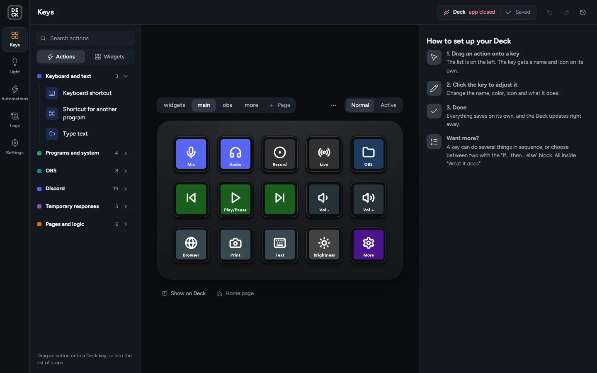
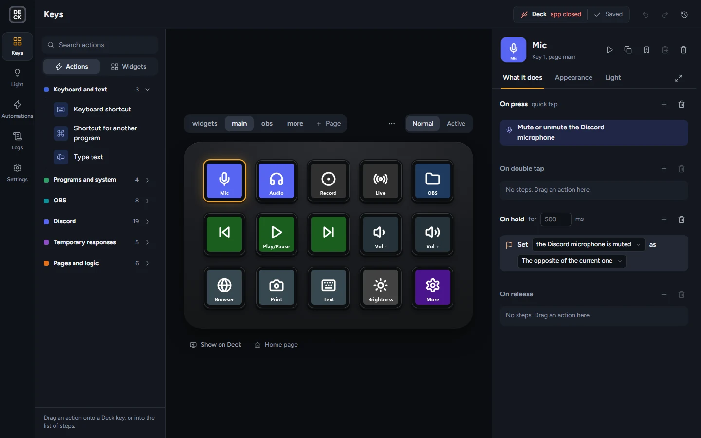
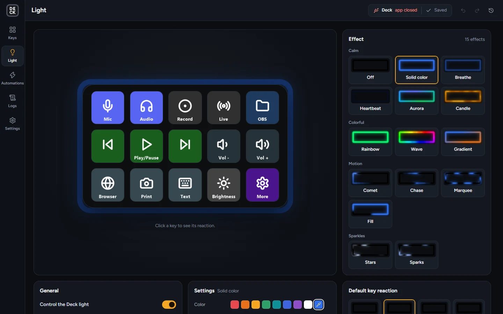
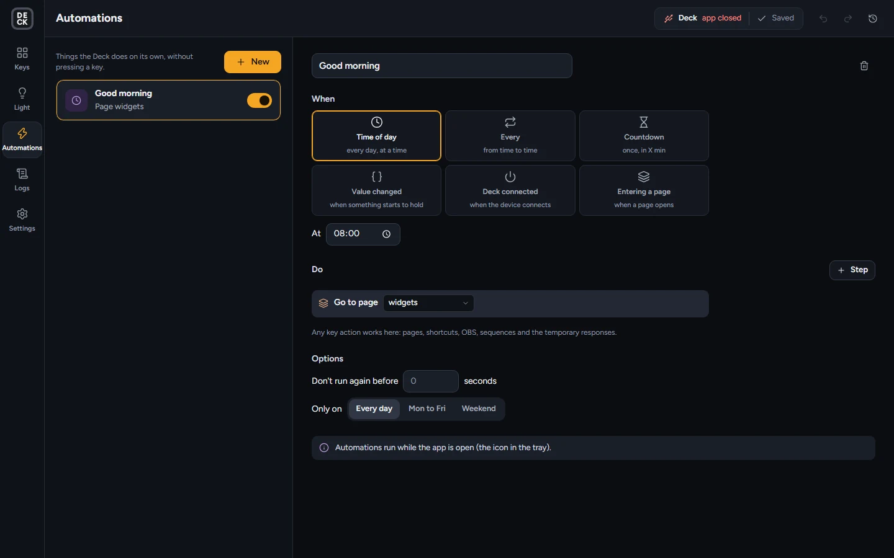
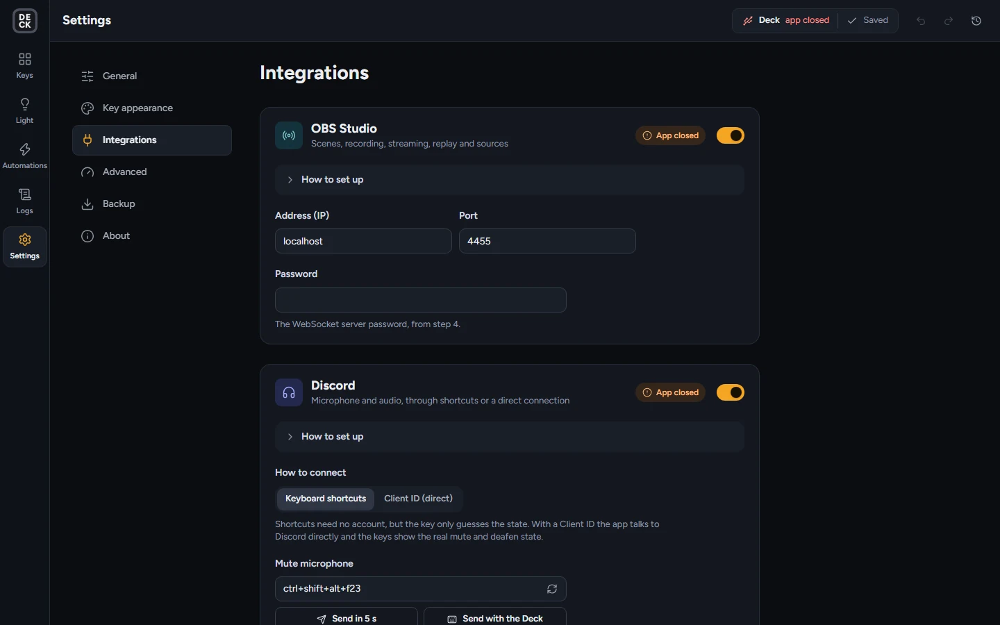

# Deck

**A better app for the Fifine AmpliGame D6 stream deck.** Set up your keys in a clean editor, make them show live
information, light up the LED ring, and connect OBS and Discord, all without Fifine's software.

## Why Deck

The D6 is a great little device: 15 keys, each with its own screen, and a ring of 18 LEDs around them. Deck lets you
get much more out of it:

- **Keys that do more than one thing.** Each key can react to a press, a double tap, a hold and a release, run
  several steps in a row, or decide between two things with an *If… then… else* block.
- **Keys that show what's going on.** Clocks, countdowns, the Windows volume, the weather, your live time in OBS. A
  key can change color when you're muted or recording.
- **A light ring that's actually yours.** 15 effects, from a calm solid color to comets and sparks, a different
  light per page, and the ring reacting to each key you press.
- **Automations.** "When the live starts, flash the ring green." "At 18:00, switch to the break page." The Deck does
  things on its own.
- **OBS and Discord built in.** Scenes, recording, streaming, replay buffer, sources; mute, deafen, push to talk,
  soundboard. OBS keys follow the real state, so the record key turns red while you're recording.
- **Plugins.** Install plugins as a `.zip`, or write your own in any language. Each plugin runs on its own, so if one
  crashes, your Deck keeps working.
- **An editor you'll enjoy using.** Drag and drop, over 1,500 icons, your own images and animated GIFs, undo, and
  a version history so you can go back to any earlier setup. Everything saves on its own and the Deck updates
  instantly.
- **Quiet.** It lives in the Windows tray, reconnects by itself if you unplug the Deck, turns the Deck off when
  your PC shuts down or sleeps, and gets out of the way during your stream.

Available in English and Portuguese.

| | |
|---|---|
|  |  |
| Each key can do several things, on press, double tap, hold or release. | 15 light effects, and reactions to your keys. |
|  |  |
| Automations run by themselves. | OBS, Discord and weather, ready to go. |

## Get it

1. Download `Deck-Setup.exe` from the [releases page](https://github.com/AffonsoPaulo/deck-control/releases).
2. Close Fifine's own app ("fifine Control Deck"), including its tray icon: only one program can talk to the D6 at
   a time.
3. Run the installer, and open the editor from the Deck icon in the tray.

You need a 64-bit Windows and a Fifine AmpliGame D6. The app isn't digitally signed yet, so Windows SmartScreen may
warn you when you run the installer (**More info › Run anyway**).

> [!NOTE]
> Deck is in pre-release (0.9), so expect some rough edges. If something doesn't work, please
> [open an issue](https://github.com/AffonsoPaulo/deck-control/issues).

## Learn more

The [user guide](docs/guide/README.md) covers everything, with screenshots:

- [Getting started](docs/guide/getting-started.md), with a tutorial for your first keys
- [Keys](docs/guide/keys.md) · [Light](docs/guide/light.md) · [Automations](docs/guide/automations.md) ·
  [Settings](docs/guide/settings.md) · [Logs](docs/guide/logs.md)
- [All actions](docs/guide/actions.md) · [Integrations and plugins](docs/guide/integrations.md) ·
  [Troubleshooting](docs/guide/troubleshooting.md)

## For developers

Deck is written in Python (the app and the device driver) with a React + TypeScript editor.

- [Development](docs/development.md): running from source, the editor, building the installer, the D6 protocol and
  the project structure.
- [Making plugins](docs/plugins.md) (in Portuguese for now) and an [example plugin](examples/plugins/pomodoro).
- [Roadmap](docs/roadmap.md) (in Portuguese).

## Credits

The D6 protocol was worked out with the help of
[akksmash/omarchy-fifine-deck](https://github.com/akksmash/omarchy-fifine-deck) and
[micah1crandell/fifine-ampligame-d6](https://github.com/micah1crandell/fifine-ampligame-d6). Icons by
[Lucide](https://lucide.dev) (ISC license); font: Figtree.

Deck is an independent project and isn't affiliated with or endorsed by Fifine.

## License

Deck is free software, licensed under the [GNU General Public License v3.0 or later](LICENSE).
