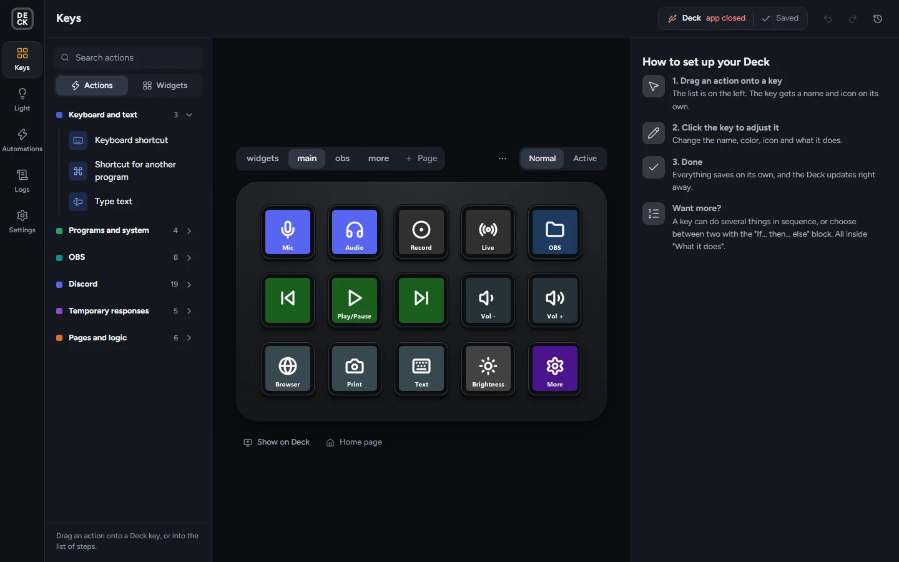

# Deck user guide

Deck is an app for the **Fifine AmpliGame D6**, the stream deck with 15 keys that each have a small screen, and a
ring of 18 LEDs around them. It replaces Fifine's software: you set up your keys in an editor that opens in the
browser, and the app runs quietly in the Windows tray.

## Start here

- [**Getting started**](getting-started.md): install, the tray icon, the editor, and a tutorial for your first keys.

## The screens

- [**Keys**](keys.md): pages, keys, what they look like and what they do; values, widgets and blocks.
- [**Light**](light.md): the LED ring, its effects, and how it reacts to your keys.
- [**Automations**](automations.md): things the Deck does by itself ("when the live starts, light the ring green").
- [**Settings**](settings.md): language, brightness, key style, advanced options, backup and version history.
- [**Logs**](logs.md): what the app is doing, and what went wrong.

## Reference

- [**Actions**](actions.md): everything a key can do, and how shortcuts for other programs work.
- [**Integrations and plugins**](integrations.md): OBS Studio, Discord, weather, and installing plugins.
- [**Troubleshooting**](troubleshooting.md): common problems and where your files are.

For developers: [making plugins](../plugins.md) (in Portuguese) and [development](../development.md) (running from
source, building the installer).
