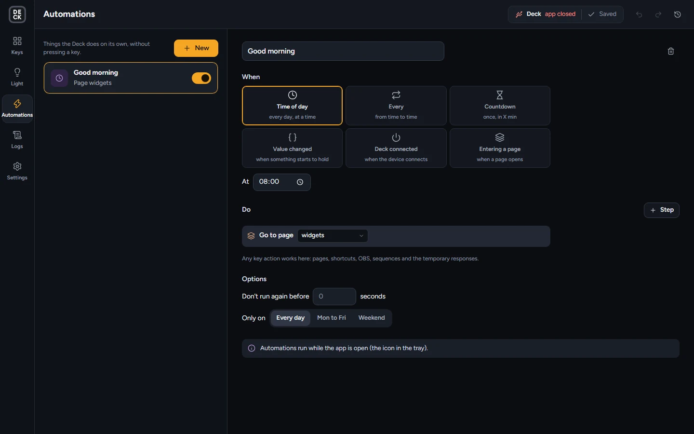

# Automations

Automations are things the Deck does on its own, without pressing a key: **when** something happens, **do** a list
of steps.

The list on the left shows your automations, each with a switch to turn it on or off. **New** creates one. Pick one
to edit it on the right.

> [!NOTE]
> Automations run while the app is open (the icon in the tray). If the app is closed at the time an automation would
> run, it doesn't run later.

## When

| Trigger | Runs… |
|---|---|
| **Time of day** | Every day at the time you set. |
| **Every** | Every N minutes, counting from when the app opened (or when you changed the automation). |
| **Countdown** | Once, N minutes after the app opens. It counts again after every app start. |
| **Value changed** | Each time a condition **starts** being true, like "OBS is streaming is yes" or "the Windows volume is greater than 80". |
| **Deck connected** | Each time the Deck connects or reconnects. |
| **Entering a page** | Each time a page opens on the Deck. |

**Value changed** only fires on the change: if the condition is already true when the app starts, nothing happens
until it turns false and then true again. The comparisons are **is**, **is not**, **is greater than**, **is less
than**, **is at least**, **is at most** and **contains**. See [Values](keys.md#values) for what you can check.

## Do

**Step** adds a step. Any key action works here: pages, shortcuts, OBS, sequences, If… then… else. The
**Temporary responses** actions are made for automations:

- **Color on the light**: lights the ring in a color for a few seconds, optionally blinking. It needs the app to
  [control the light](light.md#first-hand-the-light-over-to-the-app).
- **Paint the keys**: paints the key screens in a color for a few seconds.
- **Show a temporary page**: shows a page for a few seconds, then goes back by itself.
- **Start or pause a countdown** / **Reset a countdown**.

## Options

- **Don't run again before N seconds**: a pause after each run, so a value that flips back and forth doesn't fire
  the automation over and over.
- **Only on**: **Every day**, **Mon to Fri** or **Weekend**.

The trash button deletes the automation right away. If you deleted it by mistake, use **Undo**.

## Examples

| Name | When | Do |
|---|---|---|
| Live started | Value changed: OBS is streaming is yes | Color on the light, green, 3 s |
| End of the day | Time of day, 18:00 | Show a temporary page "break" for 30 s |
| OBS page | Entering a page: obs | Color on the light, blue, 2 s |
| Good morning | Time of day, 08:00, Mon to Fri | Change page: widgets |
