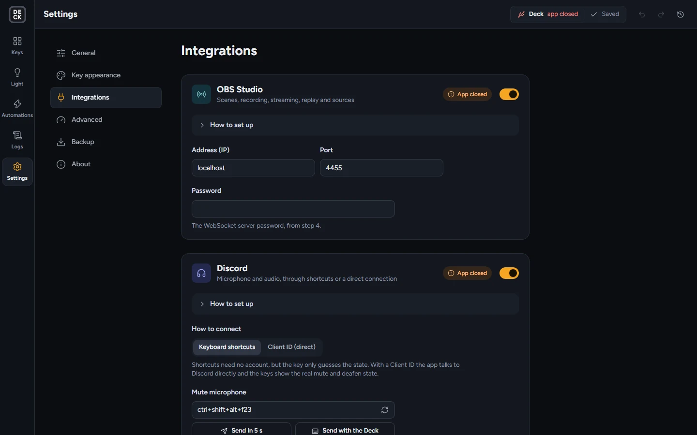
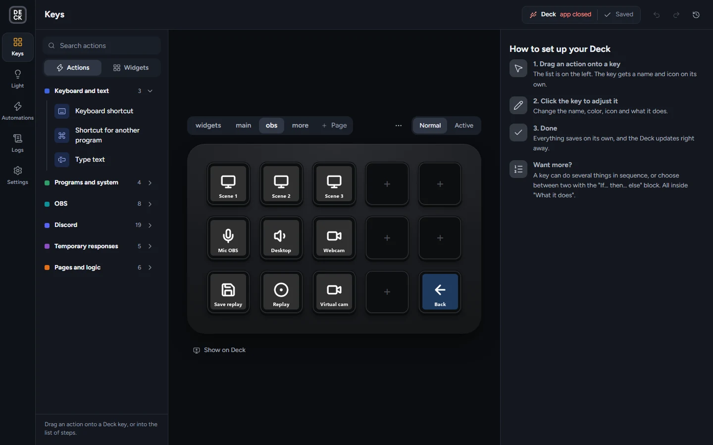

# Integrations and plugins

Integrations connect the Deck to other programs. They're plugins: three come with the app (**OBS Studio**,
**Discord** and **Weather**), and you can install more. They're all in **Settings › Integrations**.

Each integration has:

- a **switch** to turn it on or off. Turning it off keeps its settings for later;
- a **status**: **Off**, **App closed** (the Deck app isn't running), or the integration's own, like **Connected**;
- **How to set up**: the steps, right there in the editor. It opens by itself while the integration is off;
- its settings, while it's on.

When an integration is on, its actions show up in the library on the [Keys](keys.md) screen, its values can be used
in keys and automations, and its widgets show up in the Widgets tab (**See in the library** jumps there).

## OBS Studio

Scenes, recording, streaming, replay buffer, virtual camera and sources. It needs OBS 28 or newer, which comes with
everything needed; there's nothing to install in OBS.

1. In OBS, open **Tools › WebSocket Server Settings**.
2. Check **Enable WebSocket server**. The port 4455 is fine.
3. Click **Show Connect Info** and copy the password.
4. In the Deck, turn on **OBS Studio** and paste the password in **Password**. If OBS runs on another PC, put that
   PC's IP address in **Address (IP)**.

The status turns **Connected**, and the scenes and audio sources show up in the OBS actions. From then on the app
connects by itself whenever OBS opens; while OBS is closed it just waits.

**Actions**: **Switch scene**, **Record**, **Stream (go live)**, **Replay buffer**, **Virtual camera**, **Mute OBS
audio**, **Show/hide source** and **Advanced OBS command** (any obs-websocket request, for those who know the
protocol). Keys follow OBS: a scene key turns green while its scene is live, Record and Stream turn red while they're
on, a muted source turns red.

**Values**: the current scene, the live time and the recording time, plus yes/no values like "OBS is recording" and
"The stream is live". They're good for [automations](automations.md) ("when the live starts…").

## Discord

Mute, deafen, push to talk and more. There are two ways to connect, in **How to connect**:

### Keyboard shortcuts (the default)

No account or setup on Discord's website. The Deck presses shortcuts that you record in Discord once:

1. In Discord, open **User Settings › Keybinds**.
2. **Add a Keybind**, choose **Toggle Mute**, click **Record Keybind** and press the Deck's mute key (or use
   **Send in 5 s** in the Deck and switch to Discord).
3. Do the same for **Toggle Deafen**.

The shortcuts use the keys F13 to F24, which no keyboard has, so they never clash with anything, and they work even
with Discord minimized.

The catch: in this mode the Deck can't see Discord, so a key only *guesses* whether you're muted (it flips on each
press). If you mute from Discord itself, the key gets out of sync; hold the key to fix it (the sample setup does this).

### Client ID (direct)

The app talks to Discord directly, and the keys show the real mute and deafen state.

1. Go to [discord.com/developers/applications](https://discord.com/developers/applications) and click **New
   Application** (any name).
2. In **OAuth2**, copy the **Client ID**, then **Reset Secret** and copy the **Client Secret**.
3. Under **Redirects**, add `http://localhost`.
4. Paste both in the Deck and click **Authorize** in the window Discord opens (only the first time).

It only works with the Discord account that created the application. The Client Secret stays in your settings file
and is left out of exported backups.

### Discord actions

**Mute microphone** and **Deafen**, plus a set of actions that each get a shortcut of their own, which you record in
Discord's **Keybinds** under the matching name: **Push to talk**, **Push to talk (priority)**, **Push to mute**,
**Voice activity priority**, **Voice activity or push to talk**, **Streamer mode**, **Voice channel chat**, **Lock
the overlay**, **Overlay chat**, **Navigate back**, **Navigate forward**, **Join a voice channel**, **Leave the voice
channel**, **Open the soundboard**, **Soundboard while held** and **Save clip**.

The editor shows the generated shortcut on each step and how to record it (see
[Shortcuts for other programs](actions.md#shortcuts-for-other-programs)). Push to talk works as you'd expect: the
shortcut stays pressed while you hold the Deck key.

## Weather

The temperature, the chance of rain and the next days, from [open-meteo.com](https://open-meteo.com) (free, no
account, needs internet).

1. Turn it on.
2. Type your city in **City**. If there are two with the same name, add the state or country ("Springfield, IL").
3. Drag the **Weather now** widget from the library (Widgets tab) onto the Deck.

**Update every** sets how often it fetches (15 minutes by default). If the internet drops, the keys keep the last
values.

Its values (temperature now, today's high and low, condition and its icon, wind, rain, humidity, the next three days)
can go on any key: see [Values](keys.md#values).

## Installing a plugin

Plugins made by other people add actions, values and widgets. They come as a `.zip` file.

1. In **Settings › Integrations**, scroll to **Third-party plugins** and press **Install plugin (.zip)**.
2. The editor shows what's inside before installing: name, author, version, its actions, where it comes from, what
   runs (a Python script run by the Deck, or a program that comes with the plugin) and what it says it can do.
3. Press **Install** (or **Update**, if an older version is installed).
4. The plugin comes in turned off. Turn it on and fill in its settings.

> [!CAUTION]
> A plugin runs as a program on your PC. Only install plugins from people you trust.

Each plugin runs as a separate program: if it freezes or crashes, the Deck keeps working. The app restarts a plugin
that stops (up to 3 times a minute) and shows a problem in the tray and in the [log](logs.md). To remove one, use
**Remove plugin** on its card. The built-in integrations can't be removed, only turned off.

The repository has an example plugin, a Pomodoro timer, in
[`examples/plugins/pomodoro`](../../examples/plugins/pomodoro) (ready to install as `pomodoro.zip`).

## Making a plugin

See [Making plugins](../plugins.md) (in Portuguese for now): the plugin file, the protocol, and how to add values
and widgets.
