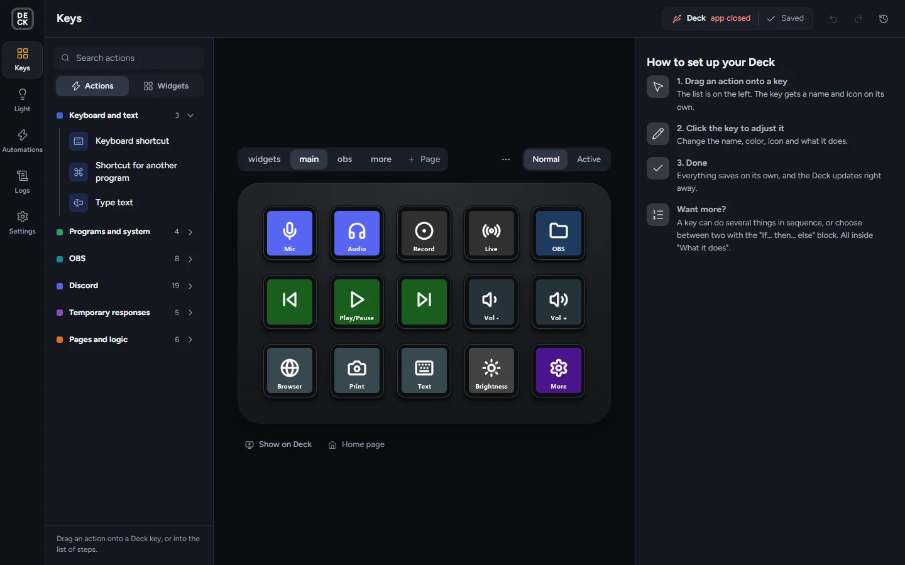
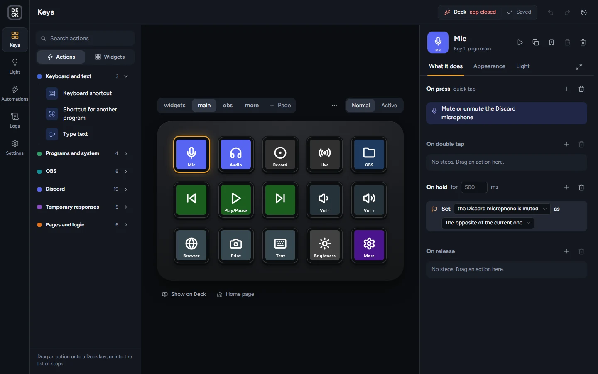
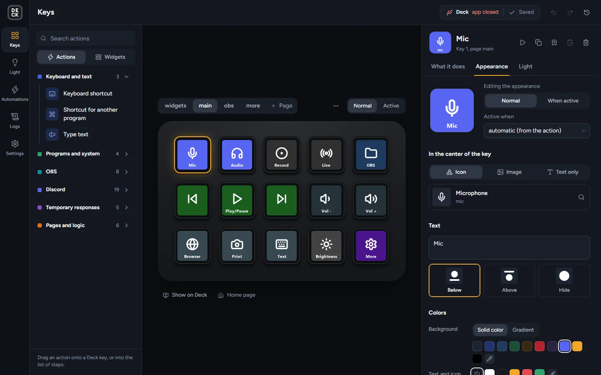
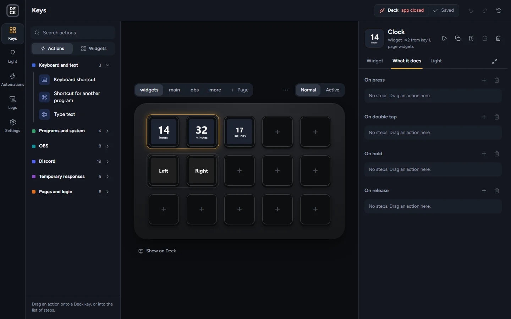

# Keys

**Keys** is where you build your Deck: which keys exist on each page, what they look like and what they do. It's the
screen the editor opens on.

The screen has three parts:

- **Library** (left): everything you can put on a key, in two tabs, **Actions** and **Widgets**.
- **Stage** (middle): the pages of your Deck and its 15 keys, drawn the way the device shows them.
- **Inspector** (right): the settings of the selected key. With nothing selected, it shows a short "How to set up
  your Deck" tutorial.

## The top bar

The top bar is the same on every screen:

- **Deck connected** / **Deck disconnected** / **Deck app closed**. "App closed" means the Deck app isn't running in
  the tray: you can keep editing, but the Deck won't update until it's open.
- **OBS connected** / **closed**, when the [OBS integration](integrations.md#obs-studio) is on.
- The save state: **Saved**, **Saving…** or **Not saved**. There's no Save button: every change is saved on its own
  about a second after you stop, and the Deck updates right away. **Not saved** (in red) means something needs
  fixing; click it to jump to the list of problems.
- **Undo** (Ctrl+Z), **Redo** (Ctrl+Y) and **Version history** (see
  [Settings › Version history](settings.md#version-history)).

## Pages

The tabs above the Deck are your pages. Each page has 15 keys, numbered 1 to 15 from the top-left, row by row.

- **+ Page** creates a page and lets you type its name right away.
- **Double-click** a tab to rename it. Every key and automation that pointed to the old name is updated.
- **Drag a key onto a tab** to move it to that page.
- The **…** button (or a right click on a tab) has **Rename**, **Use as home page**, **Show on Deck** and
  **Delete page…**. Deleting a page with keys asks first, and you can undo right after.

The **home page** is the one the Deck shows when the app opens. **Show on Deck** (under the Deck) switches the real
device to the page you're editing.

**Normal | Active** on the right of the tabs only changes the preview: it shows how the keys look when they're
"active" (recording, muted, scene on air…). It doesn't change anything in your setup.

## Putting something on a key

- **Drag** an action from the library onto a key, or
- **select a key and click** an action in the library, or
- select an **empty key** and use the quick buttons in the inspector (**See all** opens the full list).

The key gets a name, an icon and a color on its own. Actions with an on/off state also get an "active" look
automatically; for example, the Discord mic key turns red with **Muted** while the mic is off.

> [!NOTE]
> Dropping an action on a key that already does something **replaces** what it does when pressed. To add a second
> step instead, drop the action into the step list on the **What it does** tab.

You can also drag an **image file** from Windows Explorer straight onto a key.

## Moving, copying and deleting

| To… | Do this |
|---|---|
| Move or swap keys | Drag a key onto another one. If the other one is empty, the key just moves. |
| Move to another page | Drag the key onto the page tab. |
| Copy and paste | Select the key, **Ctrl+C**, select another key (on any page), **Ctrl+V**. |
| Keep a key for later | **Save to use later** in the inspector. It shows up under **Saved keys** in the Actions tab; drag it onto any page. |
| Delete | Select it and press **Delete**, or use the trash button. |
| Join keys into one big key | **Shift+click** the keys (a full rectangle) and press **Join**. See [Blocks](#blocks). |

A right click on a key has the same options. The arrow keys move the selection; **Esc** clears it.

## The inspector

Select a key and the inspector shows its name (click it to edit), where it is ("Key 1, page main") and these buttons:
**Test** (runs the key as if you pressed it on the Deck), **Copy**, **Save to use later**, **Paste** and **Delete**.

It has three tabs: **What it does**, **Appearance** and **Light**.

### What it does

A key can react to four moments, and each one has its own list of steps:

| Moment | When it runs |
|---|---|
| **On press** | A normal tap. |
| **On double tap** | Two quick taps. Keys on that page then wait a moment (the [double tap time](settings.md#advanced)) before running "On press", to tell one tap from two. |
| **On hold** | Holding the key for the time you set (500 ms by default). |
| **On release** | Letting go of the key. |

Steps read like sentences, with the fields inside them: "Press `ctrl+shift+m`", "Go to page `obs`", "Wait `2`
seconds". Use **+** to add a step, drag the handle to reorder, and **…** for the less common options. The steps of a
moment run in order, so one key can do several things.

**Repeat while held** (for shortcuts, volume, next/previous track…) keeps repeating the step while you hold the key,
like holding a key on a keyboard.

Three special steps hold other steps inside them:

- **If… then… else**: checks a [value](#values) ("If `OBS is recording` is `yes`") and runs one list or the other.
- **On/off**: the key alternates between a "when on" list and a "when off" list each time you press it. Keys with the
  same name in **Turn on together with** switch together.
- **Sequence**: a group of steps.

The **Expand** button (top right of the tab) opens the same editor in a bigger area, with the library still on the
left. **Back to Deck** or **Esc** closes it.

### Appearance

- **In the center of the key**: an **Icon** (thousands of [Lucide](https://lucide.dev/icons) icons, searchable in
  English or Portuguese), an **Image** (PNG, JPG or an animated GIF, which plays on the Deck; **Fill the whole key**
  makes it cover the screen) or **Text only** (bigger text, up to 3 lines).
- **Text**: the name on the key (Enter adds a line), and where it goes: **Below**, **Above** or **Hide**.
- **Colors**: **Background** (a **Solid color** or a **Gradient**), **Text and icon** and **Border**.
- **Sizes**: text, icon and image size. They're automatic until you change them; **Back to automatic** resets them.

#### Normal and active

A key can have a second look that shows while something is true: recording, muted, a scene on air, an On/off key
switched on. **Active when** chooses the condition (most actions pick it automatically). Then switch **Editing the
appearance** to **When active** and fill in only what changes, for example a red background and the text "LIVE";
everything else stays the same as normal.

### Light

How the ring reacts to this key, for each moment. See [Light › A different reaction for one key](light.md#a-different-reaction-for-one-key).

## Values

Values are live information the app keeps up to date: the time and date, the Windows volume, the current page, whether
OBS is recording, the weather… Plugins can add their own.

You can use them in three places:

- **In the text of a key**: a key with values in its text (like the time) becomes an **Information** key. Its
  Appearance tab can show a second line, a bar at the bottom, a background color that depends on the value, and
  **Rules** ("if the volume is muted, make the key red"). The easiest way to get one is a [widget](#widgets).
- **In If… then… else** steps on any key.
- **In [automations](automations.md)** ("when OBS starts streaming…").

## Widgets

Widgets are ready-made keys that show information and can cover more than one key. Open the **Widgets** tab in the
library and drag one onto the Deck. Widgets with several sizes show the sizes when you click them. Sizes are written
rows × keys, so 1×2 is one row, two keys wide.

| Widget | Sizes | What it shows |
|---|---|---|
| **Clock** | 1×1, 1×2, 1×3, 2×2 | The time (24 h or 12 h), with the date or the seconds on the third key. |
| **Date** | 1×1, 1×2 | Today's date. |
| **Countdown** | 1×1, 1×2 | A timer: press to start or pause, hold to reset. |
| **Gauge** | 1×1, 1×2 | A value as a bar, like the Windows volume. |
| **Free value** | 1×1 | Any value, with an optional second line. |

Plugins can bring more widgets (the weather plugin does). While you drag, the keys the widget would cover light up;
keys it would replace are marked, and you can **Undo** or **Keep the replaced ones** afterwards.

A selected widget has a **Widget** tab instead of Appearance, with its **Size**, **Options** and **Colors**. If the
options aren't enough, **Edit key by key** turns it into a normal block that you can change freely.

## Blocks

A block joins several keys into one big key. **Shift+click** a full rectangle of keys and press **Join**. In the
block's Appearance tab:

- **Distribute**: each screen shows its own part (good for text and numbers). Pick a key of the block to edit it.
- **Continuous image**: one picture across all the screens. The app skips the gap between them so it looks
  continuous.
- **Separate keys** splits it back.
- **Save as widget** keeps it under **My widgets** in the library, to reuse on any page.

## Keyboard shortcuts

| Key | What it does |
|---|---|
| Ctrl+C / Ctrl+V | Copy / paste the selected key |
| Delete | Delete the selected key |
| Arrow keys | Move the selection |
| Esc | Leave the expanded view, or clear the selection |
| Ctrl+S | Save now |
| Ctrl+Z / Ctrl+Y | Undo / redo |

Shortcuts don't act while you're typing in a field.

## Next

- [The list of all actions](actions.md)
- [Light](light.md) · [Automations](automations.md) · [Settings](settings.md)
