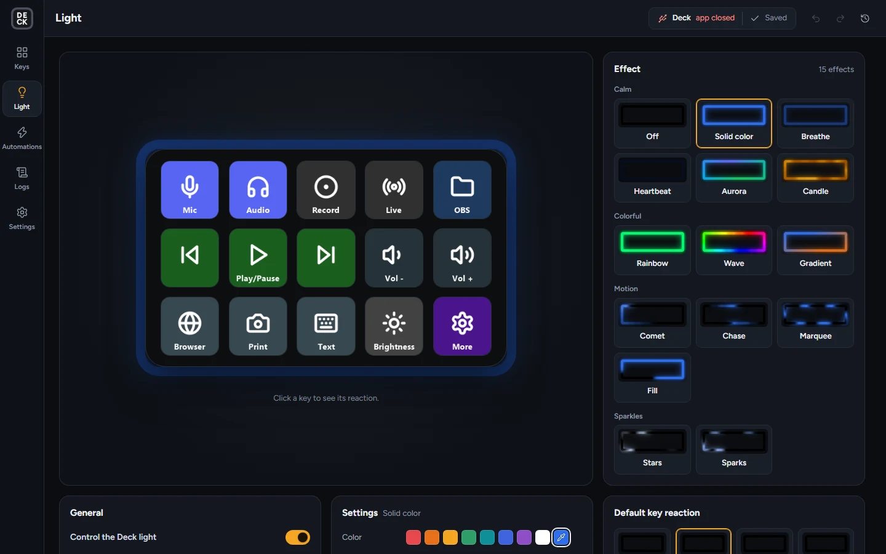

# Light

The **Light** screen controls the ring of 18 LEDs around the D6: the effect that runs all the time, and how the
ring reacts when you press a key.

## First: hand the light over to the app

The D6 runs its own light effects until you tell it otherwise. **Click the button on the back of the Deck twice,
quickly**, and the device starts taking the light from the app. A single click switches back to the device's own
effects.

The app keeps re-sending the light, so after the double click the ring picks up the app's effect by itself, without
restarting anything.

## The stage

The big drawing is a preview of your Deck with the ring around it, showing the keys of the current page. Click a
key to see its press reaction start from the LED closest to it.

The preview runs in the browser with the same math the app uses, so what you see is what the Deck will do. Clicking
here does **not** light up the real device.

## General

| Option | What it does |
|---|---|
| **Control the Deck light** | Turns the app's control of the ring on or off. While it's off, the app never touches the light and the other cards are greyed out. |
| **Brightness** | Brightness of the ring only (0–100%). The key screens have their own brightness, in [Settings › General](settings.md#general). |
| **Each page with its own light** | Saves the effect and its settings per page. A **Light page** menu appears on top of the Effect card to choose which page you're editing. Brightness, the default reaction and the screen option below stay the same for every page. |
| **Turn off with the PC screen** | The ring goes dark when Windows is locked or the monitor goes to sleep, and comes back with it. On by default. |

> [!WARNING]
> Turning **Control the Deck light** off deletes your light setup: when you turn it back on, it starts again from
> the defaults (amber solid color). If you turned it off by accident, use **Undo** or
> [Version history](settings.md#version-history) to get it back.

## Effect

Fifteen effects, in four groups. Each card shows a small live preview.

| Group | Effect | What you see |
|---|---|---|
| Calm | **Off** | Ring dark. Key reactions still work. |
| | **Solid color** | The whole ring in one color. |
| | **Breathe** | The whole ring fades in and out slowly. |
| | **Heartbeat** | A double pulse, like a heartbeat. |
| | **Aurora** | Flowing teal, green, blue and indigo. |
| | **Candle** | Each LED flickers in warm orange tones. |
| Colorful | **Rainbow** | The whole ring cycles through the colors together. |
| | **Wave** | A rainbow spread around the ring, turning. |
| | **Gradient** | A blend of two colors turning around the ring. |
| Motion | **Comet** | A bright head with a fading tail going around. |
| | **Chase** | Two heads on opposite sides chasing each other. |
| | **Marquee** | Every third LED lit, stepping like a theater sign. |
| | **Fill** | The ring fills up, then empties, in a loop. |
| Sparkles | **Stars** | LEDs twinkle softly. |
| | **Sparks** | Quick, random white-hot sparks. |

## Settings

This card only shows the options that the chosen effect uses:

- **Color** (or **Color 1** and **Color 2** for Gradient): pick a swatch or a custom color.
- **Speed**: from Slow to Very fast.
- **Trail** (Comet) or **Amount** (Stars, Sparks).
- **Direction**: **Clockwise** or **Counterclockwise**.

## Default key reaction

What the ring does when you press any key:

| Reaction | What you see |
|---|---|
| **None** | Nothing. |
| **Wave** | A wave spreads along the ring from the LED closest to the key. **Reach** sets how far it goes (up to the whole ring). |
| **Dot** | The LEDs next to the key light up briefly and fade. |
| **Pulse** | The whole ring flashes once and fades. |

The reaction color can come **From the key** (its background color), be **Fixed**, or come **From the effect**.

### A different reaction for one key

Select the key on the [Keys](keys.md) screen and open its **Light** tab. There, each moment has its own reaction:

- **On press**: **Default** follows the default reaction above; you can pick another one for this key.
- **On hold** and **On release**: nothing happens unless you pick a reaction. On hold also offers **Lit while
  held**: the LEDs near the key stay on until you let go.

If the app isn't controlling the light yet, the tab says so and has an **Open Light** button.
