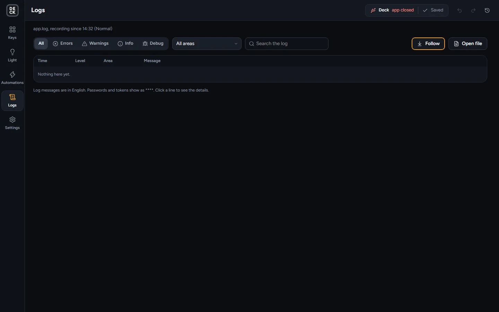

# Logs

The app writes what it does to a log file: errors, warnings and the main events (page changes, connections, saves).
When something doesn't work, the log usually says why.

The **Logs** screen is hidden by default. Turn on **Show the Logs tab in the menu** in
[Settings › Advanced](settings.md#advanced) to add it to the left menu. While it's hidden, the top bar shows a red
**Log** item whenever there are new errors or open problems; clicking it opens the log file.

## What's on the screen

- Open problems (red cards at the top): things that are wrong right now, like "The Deck is disconnected" or OBS
  that can't connect. Each one says since when, and integration problems have a button to open their settings. A
  problem goes away by itself once it's fixed.
- The log itself: one line per event, with **Time**, **Level**, **Area** and **Message**. Click a line to see its
  details (which key, which page, which action, how long it took…) and to **Copy** it.

## Finding something

- **All**, **Errors**, **Warnings**, **Info**, **Debug**: filter by level.
- **All areas**: filter by area (keys, plugins, device…).
- **Search the log**: searches the messages and their details.
- **Follow**: keeps showing the newest lines. It turns off by itself when you scroll up.
- **Open file**: opens the full log file. The screen shows only the last 3000 lines.

Opening the Logs screen marks the errors as seen, which clears the red badge on the menu.

## Good to know

- Log messages are always in English, whatever the app language. Passwords and tokens show as `****`.
- The files are in `%LOCALAPPDATA%\D6Deck\logs`. The app keeps up to 5 files of 2 MB and deletes the oldest.
- To record more detail while you chase a problem, use **Detail › Detailed** in
  [Settings › Advanced](settings.md#advanced) and pick the areas. It applies right away, no restart needed.
- **Create diagnostics package** (also in Advanced) puts the logs, your settings without passwords and the versions
  of the app and Windows in a .zip you can send to whoever is helping you.
