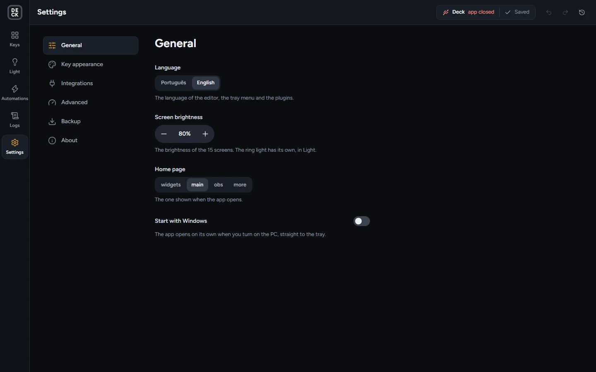
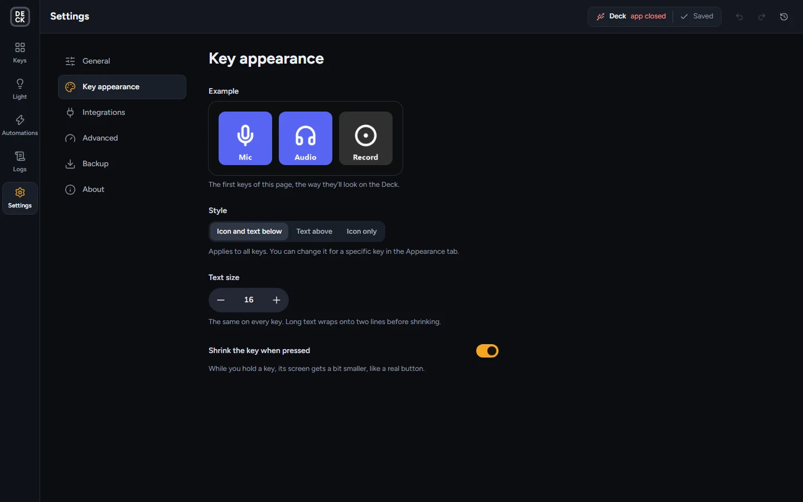
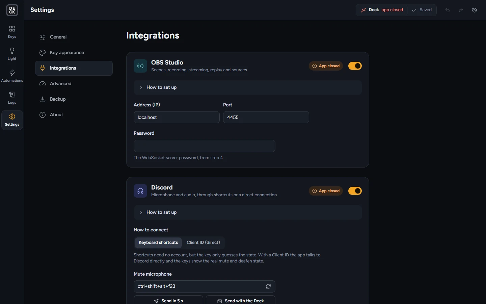
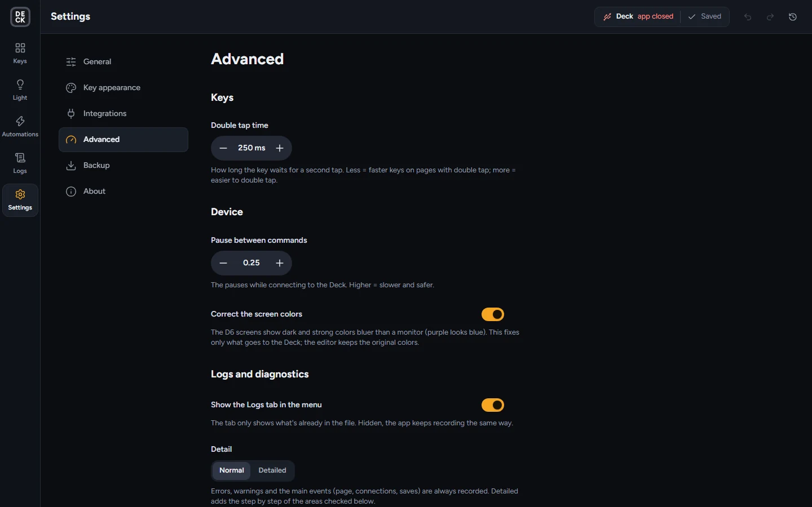
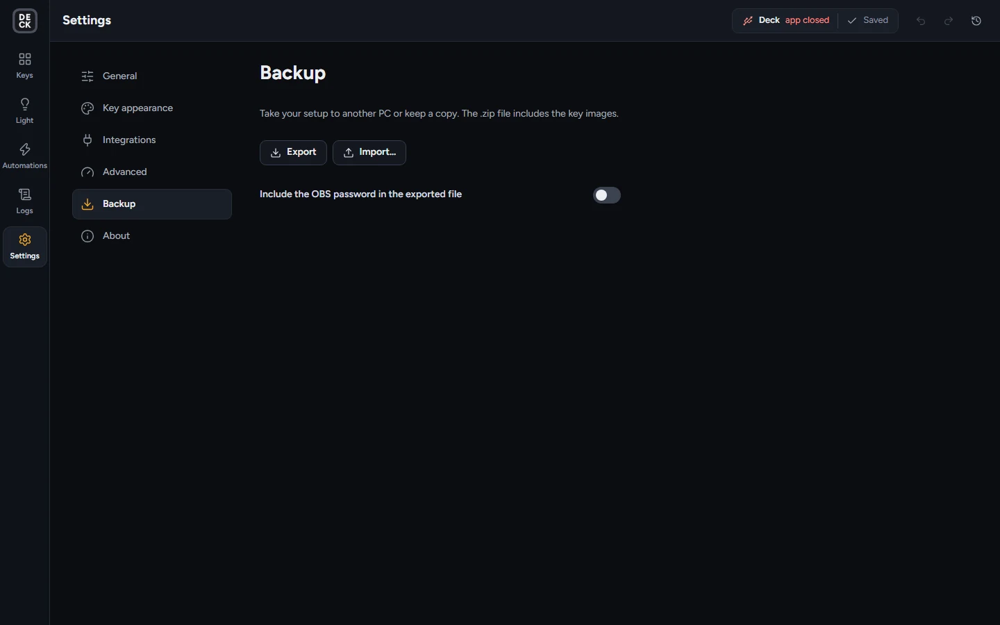
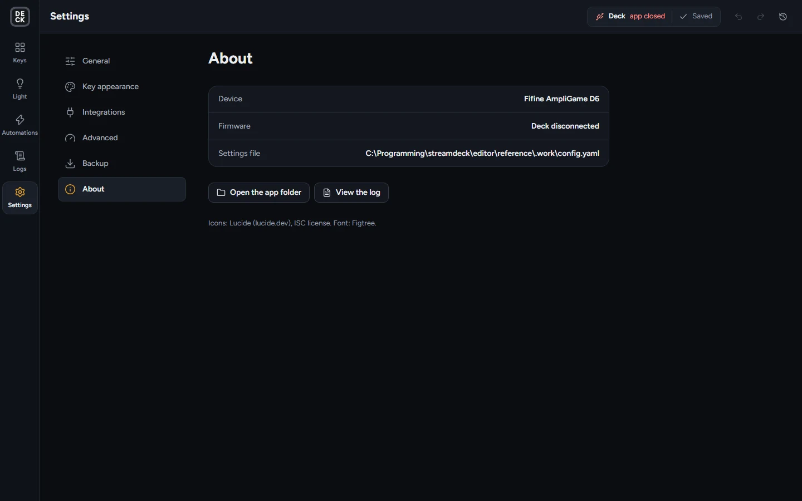

# Settings

**Settings** has six sections: **General**, **Key appearance**, **Integrations**, **Advanced**, **Backup** and
**About**. The [version history](#version-history) lives in the top bar.

## General

| Setting | What it does |
|---|---|
| **Language** | **Português** or **English**, for the editor, the tray menu and the plugins. Until you choose, the app follows the Windows language. |
| **Screen brightness** | Brightness of the 15 key screens. The ring has its own, in [Light](light.md#general). |
| **Home page** | The page the Deck shows when the app opens. |
| **Start with Windows** | Opens the app in the tray when you turn on the PC. |

> [!IMPORTANT]
> In the installed app, **Start with Windows** can only be turned **on** by the installer: run it again and check
> **Start the Deck with Windows**. Windows Defender blocks an app that isn't digitally signed from turning this on
> by itself. Turning it off from here works.

## Key appearance

The default look of every key. A key can still change it in its own [Appearance](keys.md#appearance) tab.

- **Style**: **Icon and text below**, **Text above** or **Icon only**.
- **Text size**: the same on every key. Long text wraps onto two lines before shrinking.
- **Shrink the key when pressed**: while you hold a key, its screen gets a bit smaller, like a real button.

## Integrations

OBS Studio, Discord and Weather, plus any plugin you install. Each one has a switch, a status
and a **How to set up** guide. Turning one off keeps its settings. See [Integrations and plugins](integrations.md).

## Advanced

**Keys**

- **Double tap time**: how long a key waits for a second tap. Shorter makes keys feel faster on pages with double
  tap; longer makes double tapping easier. It only affects pages that have a key with **On double tap**.

**Device**

- **Pause between commands**: the pauses the app makes while connecting to the Deck. Higher is slower and safer;
  you can leave it alone.
- **Correct the screen colors** (on by default): the D6 screens show dark and strong colors bluer than a monitor
  (purple looks blue). This fixes what goes to the Deck; the editor keeps the original colors.

**Logs and diagnostics**

- **Show the Logs tab in the menu**: adds [Logs](logs.md) to the left menu. Hidden, the app keeps recording the same
  way.
- **Detail**: **Normal** records errors, warnings and the main events. **Detailed** adds the step by step of the
  areas you check below it (Keys, Values, Automations, Plugins, Editor, Device). Use it when hunting a problem, then
  turn it back.
- **Show error on the key**: when an action fails, the key shows an ✕ for a second.
- **Notify in Windows**: a Windows notification once per problem (OBS that doesn't connect, a plugin that stopped,
  Deck disconnected). Off by default, because the notification can show up on your live.
- **Files**: where the log files are. **Open folder** opens it; **Create diagnostics package** downloads a .zip with
  the logs, your settings without passwords, and the app and Windows versions, ready to send to whoever is helping
  you.

## Backup

Take your setup to another PC, or keep a copy.

- **Export** downloads a .zip with your settings and the images your keys use.
- **Include the OBS password in the exported file**: off by default, so the file is safe to share. While it's off,
  the other integration secrets (like the Discord Client Secret) are left out too.
- **Import…** accepts a .zip (or a .yaml file). It shows what's inside, then asks:
  - **Replace everything**: your setup becomes the one in the file. Passwords the file doesn't have are kept.
  - **Only add the pages**: adds the file's pages to yours. A page whose name you already use comes in as
    "name (2)".

Either way, your current setup stays in the version history, so you can go back.

## About

The device, its firmware, where your settings file is, and buttons to **Open the app folder** and **View the log**.

## Version history

The **Version history** button in the top bar (the clock icon) opens the **History**. Every save keeps a version
there, with the time and a summary of what changed ("Page main: key 3 changed"). Changes made in a row go into the
same version.

To go back, press **Go back to this one** on a version, then **Click again to confirm**. Going back is saved as a new
version too, so you can undo it the same way.
